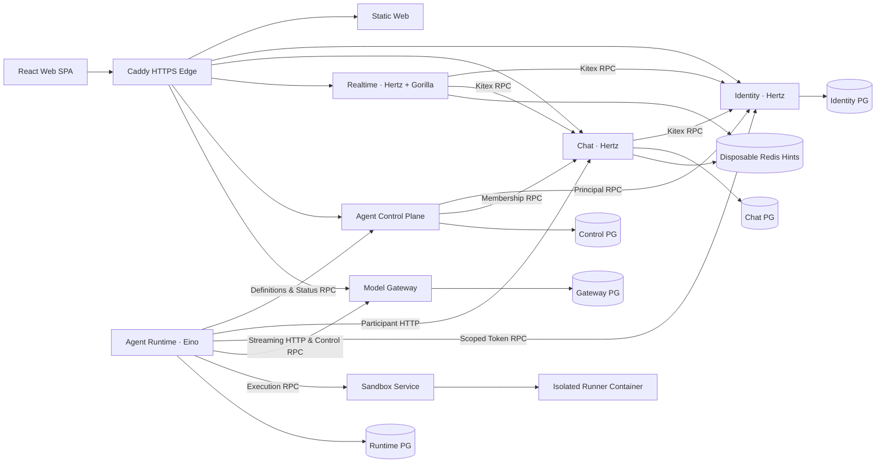

# Teamie

Teamie is a collaborative instant messaging (IM) platform built for humans and autonomous Agents to participate side by side as first-class workspace members.

The core IM platform (**Identity**, **Chat**, and **Realtime**) is strictly decoupled from Agent execution: it imports no Eino or runtime packages, holds no model provider configuration, and continues serving human conversations even if all Agent services are stopped. Agents authenticate as generic participants and interact through the same public IM APIs, workspace/conversation ACLs, and durable sync contracts as human users.

---

## Architecture Overview



### Core Engineering Principles

1. **Strict IM Independence**: Identity, Chat, and Realtime own credentials, memberships, durable messages, and realtime hints without depending on Agent modules.
2. **Service Data Ownership**: Five stateful services (**Identity**, **Chat**, **Agent Control Plane**, **Agent Runtime**, and **Model Gateway**) each own a dedicated PostgreSQL 17 database and role. **Sandbox** owns isolated filesystem workspaces and execution receipts; **Realtime** is stateless. Services never read another service's database tables.
3. **Homogeneous 4-Layer Hexagonal Clean DDD**: Every peer service under `services/{identity,chat,realtime,agent-control,agent-runtime,llm-gateway,sandbox}` is structured into `domain` (zero external dependencies), `app` (pure use-case orchestration), `adapter` (inbound HTTP/WS/RPC/CLI), and `infra` (PostgreSQL, Docker, Eino, outbound RPC/HTTP), enforced by AST-level architecture tests (`arch_test.go`).
4. **Unified Thrift IDL Pipeline**: External HTTP/SSE/WebSocket contracts (`contracts/im/*.thrift`, `contracts/agent/*.thrift`) and internal Kitex RPC contracts are compiled via `./ops/codegen.sh` into isolated Go contract modules (`contracts/gen/im`, `contracts/gen/agent`) with generated HTTP route binders (`router_gen.go`) and the frontend TypeScript SDK (`packages/api-client/src/generated.ts`).
5. **Single Production Environment & Immutable Archives**: `production` is the only deployed environment. `main` is the development trunk; each `release/vMAJOR.MINOR.PATCH` branch and tag is an immutable permanent archive deployed via digest-pinned container images.

---

## Product Capabilities

### Standalone IM & Workspace Collaboration
- **Invitation-Only Onboarding & Account Recovery**:
  - When no accounts exist, the first user registers with `BOOTSTRAP_INVITE_CODE` (default `teamie-bootstrap`) and atomically becomes the first platform administrator.
  - Platform administrators generate single-use, 7-day registration invitations in `/app/admin`; invitation consumption and account creation commit in one transaction.
  - Users can update their profile and password (revoking prior sessions). Administrators—or server operators via CLI—can issue one-hour, single-use password reset links.
- **Workspaces, Channels, DMs & Private Groups**:
  - Multi-workspace navigation with public workspace channels, 1:1 direct messages, and private groups (up to 50 participants).
  - Platform administration is an Identity role and never bypasses workspace or conversation privacy.
- **Rich Messaging, Files & Mentions**:
  - Messages support **GitHub Flavored Markdown** and **KaTeX math rendering** (`$...$` and `$$...$$`), replies, edits, and retractions (tombstone redaction across history and sync).
  - **File attachments**: Up to 4 MiB per file and 8 files per message with idempotent upload keys and conversation-authorized downloads.
  - **Structured `@` mentions**: Shared member picker across humans and Agents, persisted by participant ID with rune-accurate spans.
- **Search, File Browser & Attention Inbox**:
  - In-conversation keyword search and sent-file browser with jump-to-context pagination.
  - **Mentions & Replies (`/app/inbox`)**: Aggregates structured `@` mentions and quote replies across conversations with unread filtering and targeted read-cursor advancement.
- **Durable Sync & Realtime Hints**:
  - Monotonic per-conversation sequences, client-supplied idempotency keys, per-user durable sync cursors in PostgreSQL, and replaceable Redis/WebSocket hints (including typing indicators with immediate stop semantics).

### Human-Owned Agents & Eino Runtime
- **Human Ownership & Ordinary ACLs**:
  - Every Agent is owned by a human user who manages only its name, public description, selected workspaces (restricted to the owner's current memberships), and enabled state.
  - Browser responses expose only the public Agent profile; workspace discovery reveals only the requested workspace. Internal sessions, runs, tasks, tools, and errors are never exposed to browsers.
  - Agents use ordinary workspace and conversation permissions; moderator removals are never automatically rejoined by background reconciliation.
- **Single-Writer Global Session (`Eino v0.10.0-alpha.35`)**:
  - Each Agent has one global durable Session (`agent:<id>`) across its authorized conversations, protected by a fenced PostgreSQL writer lease and advanced serially by a native Eino `TurnLoop`.
  - Durable inbox ingestion commits before advancing IM cursors. Fresh human messages in an active source conversation request `AfterToolCalls` preemption at native safe points.
- **Source-Closed Context Engineering & Explicit Tools**:
  - Context compaction follows the configured model window, preserving source provenance DAGs and archiving evicted artifacts in PostgreSQL (`runtime_context_artifacts`) with ACL revalidation on retrieval.
  - Model text and operational errors stay internal; all public IM actions require explicit tools (`im_send_message`, `im_send_file`), alongside history/context lookup tools, recurring/one-shot scheduled wakeups (`schedule_create`, `schedule_list`, `schedule_cancel`), and web research tools (`web_search`, `web_extract`).
- **Recoverable Native Background Tasks**:
  - Long-running Sandbox commands run as durable Eino background tasks, releasing the host's foreground model slot while waiting and waking the Agent Session via durable outbox notifications upon completion.

### Model Gateway & Isolated Sandbox
- **Platform-Admin Model Gateway**:
  - Managed exclusively by platform administrators at `/app/admin/gateway`. Users and Agents never configure providers, prompts, or budgets.
  - Encrypts model provider API keys and Tavily web-search keys with AES-256-GCM (`GATEWAY_MASTER_KEY`).
  - Streams incremental NDJSON over private HTTP with disconnect cancellation, DNS-pinned public HTTPS validation (SSRF protection), and streaming credential-leakage guards.
- **Network-Isolated Docker Sandbox**:
  - Per-Agent persistent `/workspace` bind mounts with `os.Root` path-traversal confinement and fsynced mutation receipts.
  - Ephemeral execution containers run as `UID 10001` with `--network=none`, read-only rootfs, dropped capabilities, bounded CPU/memory/PIDs/disk/output (64 KiB), and zero service or provider credentials.

---

## Repository Structure

| Path | Description |
| :--- | :--- |
| [`contracts/`](contracts) | Canonical Thrift IDLs (`common/`, `im/`, `agent/`, `tpl/hz_package.yaml`) and generated Go contract modules (`gen/im`, `gen/agent`) |
| [`pkg/`](pkg) | Standalone shared Go technical mechanisms (`postgres`, `httpx`, `rpcx`, `observability`, `config`, `crypto`, `imlimits`, `imtext`) |
| [`services/identity/`](services/identity) | Identity & Principal service (`cmd/`, `cmd/identityctl/`, `internal/{domain,app,adapter,infra}`) |
| [`services/chat/`](services/chat) | Workspace, Conversation, Message & Attachment service (`cmd/`, `internal/{domain,app,adapter,infra}`) |
| [`services/realtime/`](services/realtime) | WebSocket Realtime & Typing Hint service (`cmd/`, `internal/{domain,app,adapter,infra}`) |
| [`services/agent-control/`](services/agent-control) | Agent Control Plane service (`cmd/`, `internal/{domain,app,adapter,infra}`) |
| [`services/agent-runtime/`](services/agent-runtime) | Eino Agent Runtime service (`cmd/`, `internal/{domain,app,adapter,infra}`) |
| [`services/llm-gateway/`](services/llm-gateway) | Platform-Admin Model Gateway service (`cmd/`, `internal/{domain,app,adapter,infra}`) |
| [`services/sandbox/`](services/sandbox) | Isolated Docker Sandbox service (`cmd/`, `runner/Dockerfile`, `internal/{domain,app,adapter,infra}`) |
| [`apps/web/`](apps/web) | React 19 / TypeScript / Vite browser application |
| [`packages/api-client/`](packages/api-client) | Typed browser HTTP client and Thrift-generated DTOs/route metadata (`src/generated.ts`) |
| [`tools/`](tools) | Deterministic Thrift-to-Go HTTP router generator (`thrift-go-http-codegen`), Thrift-to-TypeScript SDK generator (`thrift-ts-codegen`), and acceptance suites (`acceptance/`) |
| [`deploy/`](deploy) | Production Docker Compose, Caddyfile, feature-flag defaults, and environment template |
| [`ops/`](ops) | Code generation (`codegen.sh`), immutable release manifest tooling, deployment, backup, and rollback scripts |

---

## Verification

### 1. Contract & Codegen Synchronization
```sh
./ops/codegen.sh
node tools/thrift-go-http-codegen/index.mjs --check
node tools/thrift-ts-codegen/index.mjs --check
```

### 2. Frontend (`apps/web`)
```sh
cd apps/web
npm ci
npm run lint
npm test
npm run build
```

### 3. Shared Mechanisms, Contracts & Peer Services
```sh
for mod in pkg contracts/gen/im contracts/gen/agent \
  services/identity services/chat services/realtime \
  services/agent-control services/agent-runtime services/llm-gateway services/sandbox; do
  (cd "$mod" && go test -race ./... && go vet ./... && go build ./...)
done
```

> **Database & Docker Integration Tests**: Set `DATABASE_URL_TEST` and `TEAMIE_RUNTIME_TEST_DATABASE_URL` to disposable PostgreSQL 17 databases whose role can create and drop isolated per-test schemas. Set `SANDBOX_TEST_RUNNER_IMAGE` to exercise real Docker container isolation in `services/sandbox`.

---

## Production Delivery

- **Single Environment**: Only `production` is deployed. Disposable CI containers and local loopback processes are verification fixtures, never staging or preview environments.
- **Immutable Release Pipeline**: Pushing a new `release/vMAJOR.MINOR.PATCH` branch from the verified `main` commit triggers [`.github/workflows/release.yml`](.github/workflows/release.yml), which runs the full verification suite, builds and mirrors 12 images (`web`, `identity`, `chat`, `realtime`, `agent-control`, `agent-runtime`, `llm-gateway`, `sandbox`, `sandbox-runner`, `caddy`, `postgres`, `redis`) to Alibaba Cloud Container Registry (ACR), generates a digest-pinned `release-manifest.json`, deploys over pinned-host SSH, verifies readiness and public HTTPS, and publishes the permanent GitHub Release tag.
- **Permanent Archives & Forward Migrations**: Published `release/vx.x.x` branches and tags are never deleted, force-pushed, or modified; fixes always land on `main` and cut a new version. The current database schema vector is **Identity 3 / Chat 5 / Agent Control 1 / Agent Runtime 12 / Model Gateway 3** (`SCHEMA_V2` in [`ops/manifest.py`](ops/manifest.py)). Cross-schema image rollbacks are rejected automatically.

---

## Documentation Index

- **Engineering & Contribution**
  - [Engineering Instructions & Rules (`AGENTS.md`)](AGENTS.md)
  - [Contributing Guide (`CONTRIBUTING.md`)](CONTRIBUTING.md)
- **Architecture**
  - [System Overview & Service Guarantees](docs/architecture/overview.md)
  - [Unified Thrift IDL & 4-Layer Clean DDD Architecture](docs/architecture/ddd-idl.md)
  - [Private Agent Context Engineering](docs/architecture/context-engineering.md)
  - [Official OpenAI Agentic Model Gateway Boundary](docs/architecture/model-gateway.md)
  - [ECS Application Logging & Correlation](docs/architecture/logging.md)
- **Contracts & Boundaries**
  - [IM HTTP & Realtime Contract (`http-v1.md`)](docs/contracts/http-v1.md)
  - [Agent API & Execution Contract (`agents-v1.md`)](docs/contracts/agents-v1.md)
  - [Independent Agent Integration Boundary](docs/integrations/agent-boundary.md)
- **Product Scope & Operations**
  - [Agent Behavior Guidance](docs/product/agent-behavior.md)
  - [Phase One: Standalone IM Scope](docs/product/phase-one.md)
  - [Phase Two: Human-Owned Agents Scope](docs/product/phase-two.md)
  - [Phase Three: Continuous Runtime & Responsive IM](docs/product/phase-three.md)
  - [Production Delivery, Backup & Recovery (`ops/README.md`)](ops/README.md)
