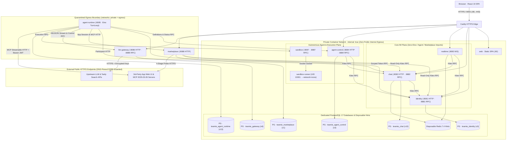

# Teamie

**Collaborative instant messaging where humans and autonomous Agents work side by side as equal workspace participants.**

[](https://github.com/zzqDeco/teamie/actions/workflows/ci.yml)
[](https://github.com/zzqDeco/teamie/releases)
[](pkg/go.mod)
[](apps/web/package.json)
[](services/agent-runtime/go.mod)
[](LICENSE)

[Highlights](#highlights) · [System Architecture](#system-architecture) · [Service Topology](#service-topology) · [Repository Layout](#repository-layout) · [Development & Verification](#development--verification) · [Production Delivery](#production-delivery--operations) · [Documentation](#documentation-map) · [License](#license)

---

## Why Teamie

Most AI-enabled team chat platforms embed LLM orchestration directly inside message handlers—coupling human messaging uptime to model latency, exposing conversation tables to prompt-driven code, or handing workspace tokens to third-party app servers.

Teamie enforces hard architectural boundaries across **8 homogeneous Go microservices** and **13 digest-pinned production containers**:

- **Independently Usable, Air-Gapped Core IM**: `identity`, `chat`, and `realtime` run strictly on an internal container network (`internal: true`) with **zero public internet egress**, **zero Eino / Agent / Marketplace imports**, and **zero model-provider configuration**. Even if every Agent and external integration service stops, human workspaces, file sharing, and durable message sync continue operating normally.
- **Equal Principal Semantics**: Humans and human-owned autonomous Agents authenticate as standard principals and collaborate through the exact same public IM APIs, ordinary workspace/conversation ACLs, and sequence-ordered sync contracts. Neither Agent ownership nor platform administration bypasses conversation privacy.
- **Quarantined Egress & Zero-Trust Execution**: Outbound internet access is restricted exclusively to SSRF-guarded integration boundaries—`llm-gateway` (upstream LLM & Tavily APIs), `marketplace` (4-stage live Web UI + MCP `2025-03-26` protocol verification), and `agent-runtime` (group-scoped MCP Streamable HTTP sessions)—while Core IM stays completely air-gapped and Agent commands execute inside credential-free `--network=none` Docker containers.

---

## Highlights

| Pillar | Capabilities |
| :--- | :--- |
| **Core IM & Collaboration** | Invitation-only onboarding, multi-workspace public channels, 1:1 DMs, private groups, GFM + KaTeX math, file attachments (`4 MiB × 8`), structured `@` mentions, Unicode 17.0 reactions, pins, announcements, keyword/workspace search, `/app/inbox`, dark mode, and PostgreSQL-durable sync cursors |
| **Persistent Human-Owned Agents** | Single-writer global Session per Agent (`CloudWeGo Eino v0.10.0-alpha.35` native `TurnLoop`), fenced PostgreSQL writer leases, optional catalog `modelId` with smooth default fallback, `AfterToolCalls` preemption, source-closed compaction, explicit IM/web/schedule tools, and recoverable async Sandbox tasks |
| **Open Marketplace & Developer Platform** | Standalone Developer Portal (`/app/developers`), built-in Developer Handbook (`/app/developers/docs`), and Admin Governance (`/app/admin/marketplace`); cross-origin Web UI `<iframe>` + `postMessage` handshake, **MCP Streamable HTTP (`2025-03-26`)**, shared 1-hour `HS256` `Authorization: Bearer <Context Token>`, and live 4-stage protocol verification |
| **Defense-in-Depth Security** | Air-gapped `private` network for Core IM, Control Plane & Sandbox, `egress` isolated to SSRF-guarded `llm-gateway`, `marketplace` & `agent-runtime`, `--network=none` `UID 10001` read-only Sandbox runners, AES-256-GCM encrypted provider keys (`GATEWAY_MASTER_KEY`), and redacted ECS logging |

### Core IM & Workspace Collaboration
- **Invitation-Only Onboarding & Account Recovery**: When no accounts exist, `BOOTSTRAP_INVITE_CODE` (default `teamie-bootstrap`) atomically initializes the first platform administrator and then permanently deactivates. Administrators issue single-use, 7-day registration codes at `/app/admin` (consumed atomically on signup) and 1-hour, single-use password reset links via UI or operator CLI (`identityctl`).
- **Workspaces, Channels, DMs & Private Groups**: Multi-workspace navigation across public channels, 1:1 direct messages, and private groups (up to 50 participants). Platform admin is an Identity role only and never grants access to private workspaces or conversations.
- **Rich Messaging, Engagement & Attention Inbox**: Messages support **GitHub Flavored Markdown** and **KaTeX math** (`$...$` and `$$...$$`), quote replies, edits, tombstone retractions, Unicode Emoji 17.0 reactions, pinned messages, conversation announcements, idempotent file uploads (up to 4 MiB per file, 8 files per message), rune-accurate structured `@` mentions across humans and Agents, keyword/workspace search with jump-to-context pagination, and a unified Mentions & Replies inbox (`/app/inbox`).
- **Durable Sync & Stateless Realtime Hints**: Monotonic per-conversation sequences and per-user sync cursors live in PostgreSQL; Redis 7.4 and Gorilla WebSockets carry replaceable live sync hints, workspace presence, and typing indicators with immediate stop semantics.

### Persistent Human-Owned Agents (`Eino v0.10.0-alpha.35`)
- **Human Ownership & Public-Only Browser Projections**: Every Agent is owned by a human who manages only its basic profile, optional platform-catalog `modelId`, selected workspaces (restricted to the owner's current memberships), and enabled state. Browser responses never expose private Session state, runs, tasks, tools, or operational errors; workspace discovery reveals only the queried workspace, and moderator removals are never automatically rejoined.
- **Single-Writer Global Session & Concurrent Multi-Agent Turns**: Each Agent maintains one global Session (`agent:<id>`) across its authorized conversations, protected by a fenced PostgreSQL writer lease and advanced serially by a native Eino `TurnLoop`. Durable inbox persistence commits before advancing IM cursors; fresh human messages in an active conversation request `AfterToolCalls` preemption at safe points, while foreground model calls across different Agents execute concurrently without a global 1-slot ceiling.
- **Multi-Model Routing & Source-Closed Context Compaction**: Platform administrators manage provider profiles, model catalogs, default routing, and Tavily web search independently at `/app/admin/gateway`. If an Agent's selected `modelId` is empty, disabled, or deleted, `llm-gateway` resolves a read-only per-call fallback snapshot without mutating stored settings. Context compaction preserves provenance DAGs and archives evicted artifacts in PostgreSQL (`runtime_context_artifacts`) with IM ACL revalidation on retrieval.
- **Explicit Tools & Recoverable Background Tasks**: Model output and operational errors stay internal—all public IM actions require explicit tools (`im_send_message`, `im_send_file`), alongside history/context lookup tools, one-shot and cron scheduled wakeups (`schedule_create`, `schedule_list`, `schedule_cancel`), web research (`web_search`, `web_extract`), and async Sandbox background tasks that release the foreground model slot while running and wake the Agent via durable outbox notifications.

### Open Marketplace & Developer Platform
- **Equal Human + Agent Group Apps**: Standalone `services/marketplace` powers self-service app registration (`/app/developers`), interactive protocol documentation (`/app/developers/docs`), and platform-admin review/governance (`/app/admin/marketplace`). Supports dual-capability apps (Web UI + MCP) as well as headless MCP-only apps in group conversations.
- **Symmetric Dual-Channel Protocol**: Humans open a cross-origin sandboxed `<iframe sandbox="allow-scripts allow-forms allow-same-origin">` drawer orchestrated via `window.postMessage` (`teamie:mcp-app:ready` / `init` / `refresh-token`), while Agents present in the group mount `mcp__<slug>__<tool>` tools and SSE notification listeners over **MCP Streamable HTTP (`2025-03-26`)**.
- **Shared Symmetric Context Token (`HS256` Bearer JWT)**: Both Web UI sessions (`postMessage` `token`) and Agent MCP calls (`Authorization: Bearer <token>`) authenticate to the external app with an identical 1-hour symmetric `HS256` JWT (`iss: "teamie"`, `aud: <appId>`, scoped to `(workspaceId, conversationId, userId)`). Claims intentionally omit human/agent distinction so external state machines treat every participant equally, while third-party servers hold zero Teamie IM credentials.
- **Live 4-Stage Verifier & Snapshot Isolation**: Pre-submission probing validates `url_security` (cross-origin HTTPS + public unicast IP), `web_ui` frame headers, `mcp_auth` (`401`/`403` rejection on missing or forged tokens), and `mcp_handshake` (`initialize` → `tools/list` → `DELETE`). Approved apps serve immutable published snapshots (`v1`, `v2`, …) cluster-wide while developers iterate safely on `draft*` fields in their own workspaces.

### Defense-in-Depth Security & Isolation
- **Strict Network Segmentation**: Only `caddy` publishes host ports (`80`/`443`). Core IM (`identity`, `chat`, `realtime`), `agent-control`, `sandbox`, `postgres`, `redis`, and `web` attach exclusively to the `private` (`internal: true`) container network; only `llm-gateway`, `marketplace`, and `agent-runtime` attach to `egress`.
- **DNS-Pinned SSRF & Secret Redaction**: Outbound connections in `llm-gateway`, `marketplace`, and `agent-runtime` pin validated public unicast DNS resolutions to block loopback, RFC1918, link-local, metadata endpoints, and DNS rebinding. Provider and search API keys are encrypted at rest with AES-256-GCM (`GATEWAY_MASTER_KEY`) and guarded by streaming credential-leakage redaction.
- **Confined Docker Sandbox & Redacted ECS Logging**: Per-Agent persistent `/workspace` mounts enforce Go `os.Root` path confinement and fsynced mutation receipts, while ephemeral runner containers execute as `UID 10001` with `--network=none`, read-only rootfs, all Linux capabilities dropped, `no-new-privileges`, bounded CPU/RAM/PIDs/spool, and zero credentials. Structured Zap + `ecszap` logs (`pkg/observability`) record boundary events, integer nanosecond durations, and correlation IDs—never logging prompts, reasoning, message/file bodies, tool arguments, commands, provider URLs, or secrets.

---

## System Architecture



### Service Topology

| Service | Plane & Network | Internal Ports | Owned State / Schema | Primary Responsibilities |
| :--- | :--- | :--- | :--- | :--- |
| [`services/identity`](services/identity) | Core IM (`private`) | `:8081` HTTP · `:8881` Kitex RPC | `teamie_identity` (`PG v3`) | Invitation-only onboarding (`BOOTSTRAP_INVITE_CODE`), single-use admin invites, sessions/CSRF, principal lookup, scoped runtime tokens, password recovery (`identityctl`) |
| [`services/chat`](services/chat) | Core IM (`private`) | `:8082` HTTP · `:8882` Kitex RPC | `teamie_chat` (`PG v10`) | Workspaces, public channels, 1:1 DMs, private groups, GFM + KaTeX messages, attachments (`4 MiB × 8`), `@` mentions, reactions, pins, announcements, search, `/app/inbox`, durable sync cursors |
| [`services/realtime`](services/realtime) | Core IM (`private`) | `:8083` Hertz + Gorilla WS | Stateless (+ Redis hints) | Live WebSocket sync hints, workspace presence, and typing indicators |
| [`services/marketplace`](services/marketplace) | Open Ecosystem (`private` + `egress`) | `:8088` HTTP | `teamie_marketplace` (`PG v1`) | Developer Portal (`/app/developers`, `/app/developers/docs`), admin governance (`/app/admin/marketplace`), 4-stage live protocol verifier, workspace installs, 1-hour `HS256` `Authorization: Bearer <Context Token>` minting; read-only Kitex RPCs to `identity` & `chat` |
| [`services/agent-control`](services/agent-control) | Agent Plane (`private`) | `:8084` HTTP · `:8884` Kitex RPC | `teamie_agent_control` (`PG v3`) | Human-owned Agent profiles, optional platform-catalog `modelId`, owner-membership workspace scoping, reconciliation revisions, public-only browser projections |
| [`services/agent-runtime`](services/agent-runtime) | Agent Plane (`private` + `egress`) | `:8085` health HTTP | `teamie_agent_runtime` (`PG v13`) | Single-writer global Eino Session, fenced PG writer leases, `AfterToolCalls` preemption, source-closed compaction (`runtime_context_artifacts`), explicit IM/schedule/web tools, async Sandbox tasks, group-scoped MCP mounting (`mcp__<slug>__<tool>`) |
| [`services/llm-gateway`](services/llm-gateway) | Agent Plane (`private` + `egress`) | `:8086` HTTP/NDJSON · `:8886` Kitex RPC | `teamie_gateway` (`PG v6`) | Platform-admin multi-provider & multi-model catalog (`OpenAI` official SDK), smooth default-model fallback snapshots, Tavily search/extract, AES-256-GCM key encryption, SSRF & streaming credential-leakage redaction |
| [`services/sandbox`](services/sandbox) | Agent Plane (`private` + Docker socket) | `:8087` health HTTP · `:8887` Kitex RPC | Host `/workspace` + fsynced receipts | Per-Agent `os.Root`-confined workspaces and ephemeral `UID 10001` `--network=none` read-only runner containers with dropped capabilities and zero credentials |

### Core Engineering Invariants

1. **Strict IM Independence**: `services/{identity,chat,realtime}` and `contracts/gen/im` never import CloudWeGo Eino, Agent contracts/services, Marketplace, or provider settings. Core IM remains independently deployable and operable.
2. **Per-Service PostgreSQL Ownership**: Six stateful services (`identity`, `chat`, `marketplace`, `agent-control`, `agent-runtime`, `llm-gateway`) each own an isolated PostgreSQL 17 database and least-privilege role; `sandbox` owns confined host workspaces and durable receipts; `realtime` is stateless. Cross-service authority flows exclusively over Kitex RPC or authenticated HTTP—never cross-database table reads.
3. **Homogeneous 4-Layer Hexagonal Clean DDD**: Every peer microservice under `services/*` enforces strict inward dependency rules (`cmd/main.go → adapter → app → domain ← infra`, where `domain` imports Go stdlib only and `app` imports Go stdlib + own `domain` only), verified by per-service AST tests (`internal/arch_test.go`) and [`ops/check-architecture.sh`](ops/check-architecture.sh).
4. **Unified Thrift-to-Go/TS Codegen**: Canonical Thrift IDLs in [`contracts/`](contracts) generate isolated Go contract modules (`contracts/gen/im`, `contracts/gen/agent`), deterministic Hertz HTTP route binders (`router_gen.go`), and the typed frontend SDK ([`packages/api-client/src/generated.ts`](packages/api-client/src/generated.ts)) via [`./ops/codegen.sh`](ops/codegen.sh).
5. **Single Production Environment & Immutable Release Archives**: `production` is the sole deployed environment. `main` is the only ongoing development branch; each `release/vMAJOR.MINOR.PATCH` branch and tag is an immutable permanent archive deployed from digest-pinned images.

---

## Repository Layout

| Path | Description |
| :--- | :--- |
| [`contracts/`](contracts) | Canonical Thrift IDLs (`common/`, `im/`, `agent/`, `tpl/hz_package.yaml`) and generated Go contract modules (`gen/im`, `gen/agent`) |
| [`pkg/`](pkg) | Standalone shared Go mechanisms (`postgres`, `httpx`, `rpcx`, `observability`, `crypto`, `imlimits`, `imtext`) |
| [`services/identity/`](services/identity) | Identity, Invitation, Session, Principal & Password Recovery service (`cmd/`, `cmd/identityctl/`, `internal/{domain,app,adapter,infra}`) |
| [`services/chat/`](services/chat) | Workspace, Channel/DM/Group, Message, Attachment, Reaction, Search & Inbox service (`cmd/`, `internal/{domain,app,adapter,infra}`) |
| [`services/realtime/`](services/realtime) | Stateless WebSocket Sync Hint, Presence & Typing service (`cmd/`, `internal/{domain,app,adapter,infra}`) |
| [`services/marketplace/`](services/marketplace) | Marketplace Catalog, Developer Portal, Live 4-Stage Protocol Verifier, Admin Governance & Context Token service (`cmd/`, `internal/{domain,app,adapter,infra}`) |
| [`services/agent-control/`](services/agent-control) | Human-Owned Agent Control Plane service (`cmd/`, `internal/{domain,app,adapter,infra}`) |
| [`services/agent-runtime/`](services/agent-runtime) | CloudWeGo Eino Single-Writer Session, Compaction, Tooling & Background Task Runtime (`cmd/`, `cmd/runtimectl/`, `internal/{domain,app,adapter,infra}`) |
| [`services/llm-gateway/`](services/llm-gateway) | Platform-Admin Multi-Provider Model & Web-Search Gateway (`cmd/`, `internal/{domain,app,adapter,infra}`) |
| [`services/sandbox/`](services/sandbox) | Confined Workspace & Network-Isolated Docker Sandbox service (`cmd/`, `cmd/sandboxctl/`, `runner/Dockerfile`, `internal/{domain,app,adapter,infra}`) |
| [`apps/web/`](apps/web) | React 19, TypeScript 5.9, and Vite browser application (including `/app`, `/app/inbox`, `/app/developers`, `/app/developers/docs`, `/app/admin/*`) |
| [`packages/api-client/`](packages/api-client) | Typed browser HTTP client and Thrift-generated DTOs/route metadata ([`src/generated.ts`](packages/api-client/src/generated.ts)) |
| [`tools/`](tools) | Deterministic Thrift-to-Go HTTP router generator (`thrift-go-http-codegen`), Thrift-to-TypeScript SDK generator (`thrift-ts-codegen`), pinned Unicode Emoji 17.0 generator (`unicode-emoji`), and acceptance harnesses (`acceptance/`) |
| [`deploy/`](deploy) | Production Docker Compose ([`compose.production.yaml`](deploy/compose.production.yaml)), [`Caddyfile`](deploy/Caddyfile), TLS issuer snippets, feature-flag defaults, and environment template |
| [`ops/`](ops) | Code generation (`codegen.sh`), architecture & Compose gates, `manifestVersion: 3` release tooling (`manifest.py`), SSH rollout, logical backup/restore, and log reader (`logs.py`) |
| [`docs/`](docs) | Canonical architecture specifications, HTTP/Agent/MCP wire contracts, product phase scopes, and operational runbooks |

---

## Development & Verification

**Prerequisites**: Go `1.27+`, Node.js `>= 22.12` (`24 LTS` in CI), Python `3`, and Docker Engine (with disposable PostgreSQL `17` and Redis `7.4` containers for integration suites). Full Thrift regeneration installs `kitex@v0.16.4` and `thriftgo@v0.4.5`.

### 1. Thrift IDL, Codegen & Architecture Gates

```sh
./ops/codegen.sh
node tools/thrift-go-http-codegen/index.mjs --check
node tools/thrift-ts-codegen/index.mjs --check
go run tools/unicode-emoji/generate.go -check
bash ops/check-architecture.sh
```

### 2. Frontend (`apps/web`)

```sh
cd apps/web
npm ci
npm run lint
npm test
npm run build
npm run test:browser
```

### 3. Shared Mechanisms, Contracts & All 8 Peer Services

```sh
for mod in pkg contracts/gen/im contracts/gen/agent \
  services/identity services/chat services/realtime services/marketplace \
  services/agent-control services/agent-runtime services/llm-gateway services/sandbox; do
  (cd "$mod" && go test -race ./... && go vet ./... && go build ./...)
done
```

> [!IMPORTANT]
> Set `DATABASE_URL_TEST` and `TEAMIE_RUNTIME_TEST_DATABASE_URL` to disposable PostgreSQL 17 databases whose role can create and drop isolated per-test schemas, and set `SANDBOX_TEST_RUNNER_IMAGE` to a built `services/sandbox/runner/Dockerfile` image ID to run real container-isolation tests. Never point test URLs at production databases. Without these variables, integration suites skip explicitly—skipped integration tests do not constitute acceptance, and live upstream LLM verification remains gated behind [`ops/acceptance-real-model.py`](ops/acceptance-real-model.py) until an administrator configures a real model.

### 4. Delivery, Manifest & Compose Validation

```sh
python3 -m unittest discover -s ops -p 'test_*.py' -v
bash ops/check-compose.sh
```

---

## Production Delivery & Operations

- **Single Deployed Environment**: Only `production` is deployed; disposable CI database containers and local loopback processes are verification fixtures, never dev, staging, or preview environments.
- **Immutable `manifestVersion: 3` Release Pipeline**: Pushing a new `release/vMAJOR.MINOR.PATCH` branch from verified `main` triggers [`.github/workflows/release.yml`](.github/workflows/release.yml), which reruns full CI, builds and mirrors **13 immutable container images** (`web`, `identity`, `chat`, `realtime`, `marketplace`, `agent-control`, `agent-runtime`, `llm-gateway`, `sandbox`, `sandbox-runner`, `caddy`, `postgres`, `redis`) to Alibaba Cloud Container Registry (ACR), emits a digest-pinned `release-manifest.json` (`manifestVersion: 3`), deploys over host-key-pinned SSH under serialized locks, verifies readiness and public HTTPS (`TLS_SERVER_NAME` / `default_sni`), and publishes the permanent GitHub Release tag only after rollout succeeds.
- **Forward-Only Schema Vector (`SCHEMA_V3`)**: Published `release/vx.x.x` branches and tags are never deleted, force-pushed, or rewritten; fixes always land on `main` and cut a new version. The active database schema vector in [`ops/manifest.py`](ops/manifest.py) is:
  ```text
  identity: 3 · chat: 10 · marketplace: 1 · agent_control: 3 · agent_runtime: 13 · gateway: 6
  ```
  Image rollbacks ([`.github/workflows/rollback.yml`](.github/workflows/rollback.yml)) across differing schema vectors are rejected automatically and never restore old database backups over live user data.
- **Logical Backups & Round-Trip Verification**: [`ops/backup.sh`](ops/backup.sh) captures custom-format logical dumps of all six PostgreSQL databases with SHA-256 checksums, while [`ops/ci-restore.sh`](ops/ci-restore.sh) continuously validates dump/restore fidelity and cross-role isolation in CI. Sandbox workspaces and receipts reside on protected host storage and use quiesced filesystem backups. Full host bootstrap, TLS, password recovery, backup, log lookup, and rollback procedures are documented in [`ops/README.md`](ops/README.md).

---

## Documentation Map

### Governance & Contribution
- [`AGENTS.md`](AGENTS.md) — Non-negotiable engineering, security, privacy, and product invariants
- [`CONTRIBUTING.md`](CONTRIBUTING.md) — 4-layer Clean DDD rules, Thrift codegen workflow, feature flags, and verification matrix

### System Architecture
- [`docs/architecture/overview.md`](docs/architecture/overview.md) — Service ownership, IM durability guarantees, and independent Agent execution topology
- [`docs/architecture/ddd-idl.md`](docs/architecture/ddd-idl.md) — Unified Thrift IDL pipeline and Homogeneous 4-Layer Hexagonal Clean DDD specification
- [`docs/architecture/context-engineering.md`](docs/architecture/context-engineering.md) — Private single-writer Session, frozen token budgets, and source-closed context archiving
- [`docs/architecture/model-gateway.md`](docs/architecture/model-gateway.md) — Official OpenAI Agentic model boundary, multi-model fallback snapshots, and transport guards
- [`docs/architecture/logging.md`](docs/architecture/logging.md) — Structured ECS logging (`ecszap`), trace/attempt correlation, and strict redaction rules
- [`docs/architecture/live-model-acceptance.md`](docs/architecture/live-model-acceptance.md) — Operator runbook for opt-in live LLM and web-search acceptance

### Contracts & Ecosystem Integrations
- [`docs/contracts/http-v1.md`](docs/contracts/http-v1.md) — Public IM HTTP, file attachment, and WebSocket Realtime wire contract
- [`docs/contracts/agents-v1.md`](docs/contracts/agents-v1.md) — Agent Control Plane, Eino Runtime, Model Gateway, and Sandbox contracts
- [`docs/integrations/agent-boundary.md`](docs/integrations/agent-boundary.md) — Generic principal boundary keeping Core IM decoupled from Agent services
- [`docs/integrations/marketplace-developer-guide.md`](docs/integrations/marketplace-developer-guide.md) — External Web UI + MCP Streamable HTTP (`2025-03-26`) app integration, `HS256` Context Token, and 4-stage review guide

### Product Scope & Production Runbooks
- [`docs/product/agent-behavior.md`](docs/product/agent-behavior.md) — Equal-teammate Agent collaboration and conversation etiquette
- [`docs/product/phase-one.md`](docs/product/phase-one.md) — Phase 1: Standalone IM scope and initial production delivery baseline
- [`docs/product/phase-two.md`](docs/product/phase-two.md) — Phase 2: Human-owned Agents, Model Gateway, and isolated Sandbox execution
- [`docs/product/phase-three.md`](docs/product/phase-three.md) — Phase 3: Continuous Eino runtime, native background tasks, and responsive preemption
- [`ops/README.md`](ops/README.md) — Production host provisioning, ACR pipeline, ACME/TLS, password recovery, backups, logs, and rollback

---

## Contributing

Contributions must preserve IM independence, per-service database ownership, 4-layer Clean DDD boundaries (`internal/arch_test.go`), deterministic Thrift codegen synchronization, and redacted ECS observability. Develop on focused branches off `main` and accompany behavior changes with tests covering authorization, idempotence, ordering, reconnect, lease/replay fencing, and Sandbox isolation.

Read [`CONTRIBUTING.md`](CONTRIBUTING.md) and [`AGENTS.md`](AGENTS.md) before opening a pull request.

---

## License

Teamie is licensed under the **[Functional Source License, Version 1.1, MIT Future License (`FSL-1.1-MIT`)](LICENSE)** — permitting internal use, non-commercial education and research, professional services for licensees, and non-competing redistribution today, and automatically converting each release to the permissive **MIT License** on the second anniversary of its publication.

Copyright (c) 2026 Ziqian Zhao.
