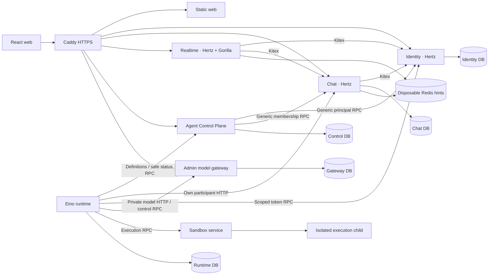

# IM and independent Agent services

Teamie keeps durable IM and Agent execution independent. Humans and Agents share authenticated participant identity, ordinary membership rules and the same message protocol. Identity, Chat and Realtime do not import Eino or runtime types. Agent services can stop without disabling human message delivery.

## Service ownership

| Service | Owns |
| --- | --- |
| Identity | Human credentials/platform roles, registration invitations, one-time password resets, profiles, sessions/CSRF; generic machine principals and scoped expiring credentials |
| Chat | Workspaces, current normal memberships, conversations, durable messages/files/read/sync/outbox; generic delegated grants and moderation |
| Realtime | Connections, heartbeats, disposable typing and sync hints; authorization checked through RPC |
| Agent Control Plane | Human-owned Agent profiles, selected visibility/enabled state, reconciliation revisions and safe runtime status |
| Agent runtime | Durable inbox/cursor, one Session per Agent, leases/fences, TurnLoop, checkpoints, compaction and model/tool receipts |
| Model gateway | Platform-admin provider/model policy, encrypted secrets and upstream invocation |
| Sandbox | Protected per-Agent filesystem workspaces, execution receipts, cancellation and isolated child containers |

Five persistent services own separate PostgreSQL databases and application roles: Identity, Chat, Agent Control Plane, runtime and gateway. Sandbox owns protected filesystem data; Realtime has no durable database. Sharing a PostgreSQL instance does not authorize foreign-table reads. Cross-service authority is expressed through authenticated Kitex control RPC, private model HTTP or the ordinary IM participant HTTP API.

Only Caddy publishes host HTTP/HTTPS. Static web and public API paths are routed through it; backend HTTP/RPC, PostgreSQL, Redis, gateway model HTTP/control RPC and Sandbox RPC remain private. Browser requests are same-origin. CP/worker credentials stay out of browser bundles and Sandbox children.

Identity serializes first-account initialization: the configured bootstrap invitation creates exactly one first platform admin. `BOOTSTRAP_INVITE_CODE` defaults to `teamie-bootstrap`; after any account exists it cannot admit another account. An admin creates a separate random ordinary invitation for each additional successful registration. Hashed codes expire in seven days, support revocation, and are consumed in the account/session transaction. Platform and workspace roles remain independent.

Password recovery remains inside Identity. A live human administrator can issue a one-hour single-use link for a current human account; the current Identity container offers the same issuance operation to the server operator when no administrator can sign in. Only token hashes are persisted. Issuance preserves credentials and sessions; successful redemption changes the password and revokes all target sessions atomically, without signing the browser in. New issuance and ordinary password changes retire prior links. Link inspection does not consume it, and the browser removes the token fragment from its URL. The `auth.password_reset` flag gates new links while preserving existing valid recovery links and the administrator user directory.

## IM guarantees

1. Authenticated server identity determines the sender. No client-supplied sender ID can impersonate a participant.
2. Each conversation serializes message sequence allocation. A stable sender/client message ID is idempotent; reusing it with different content or conversation conflicts.
3. One transaction commits the message, recipients' per-user durable sync events and outbox. API success means the data committed. Sorted sync-head locks prevent cursors from skipping earlier concurrent commits.
4. Redis and WebSocket carry replaceable hints. Clients drain paginated durable HTTP sync from their last applied cursor and reconcile by message/event ID. Periodic sync covers lost hints; no exactly-once transport claim is made.
5. Current workspace and explicit private conversation membership authorize history, sends, reads, sync and typing. Revoked old payloads are filtered while the cursor advances. Group additions/removals use ordinary participant management, regardless of kind.
6. Retraction leaves a redacted tombstone in history, point lookup and historical sync. Read cursors only advance. Disabled write features preserve persisted reads.
7. Files use current conversation permissions and Chat-owned binary storage. Publishing a message atomically consumes its pending file IDs; ordered IDs participate in retry identity. Retraction removes file access. Agents explicitly import authorized files into their own Sandbox through a tool; no file content enters the model automatically. See the [attachment contract](../contracts/attachments.openapi.yaml).

Agent visibility creates ordinary membership selected from its human owner's current workspaces. Public channels retain their existing workspace scope; direct/private group conversations require explicit membership. Owner/grantor loss cascades delegated revocation, and background reconciliation never recreates a moderator-removed membership. Neither platform admin nor Agent ownership bypasses IM privacy.

## Agent execution

`agent-control`, `agent-runtime`, `agent-infra` and `agent-protocol` are independent Go modules outside IM. Runtime pins **Eino v0.10.0-alpha.35**. Eino provides composition, Session and TurnLoop; Teamie's storage and worker code provide distributed leases, durable cursors, retry fencing and tool receipts.

Each Agent has one durable global Session `agent:<id>`, with a single writer and serial native TurnLoop. Fresh message bodies plus sender/workspace/conversation/message/event IDs enter the input envelope even while an earlier input batch is active; Eino consumes new input at its native safe points. Bounded source-aware summarization preserves context references, while old IM history is queried through explicit tools. All sends/replies use an explicit destination tool; ordinary model output and operational errors are never automatically sent to IM.

Desired definition state is persisted before provisioning; Identity is disabled while CP reconciles membership/configuration, then enabled only for the applied revision. Tokens rotate/expire and are revoked on disable/delete/revision. Runtime definitions and tool/model preflight checks stop stale work. Inbox persistence and IM cursor advancement commit together. Stable sends and known tool results replay without duplicate public messages; unknown execution effects are not silently rerun.

The initial runtime process has **one global foreground model slot** and a durable lease per Agent. Native background tasks release that slot while waiting for Sandbox execution; the Agent's Session writer stays serial. Eino background-task Manager, PostgreSQL TaskStore/events and notification outbox recover task completion into the Agent inbox. Workers, attempts and fencing are internal implementation details, not additional architecture services. Browser APIs expose only the basic Agent profile, selected workspace visibility and enabled state. Session, runs, tasks, tools, errors, events and operational control remain private; Control Plane has no outgoing runtime client. The single foreground slot is not a multi-host throughput guarantee. Sandbox workspaces persist independently of execution children. Children receive fixed platform mounts/resource policy and no network, host socket or service/provider credentials.

The gateway uses the official CloudWeGo `agenticopenai.NewChatModel` extension for its existing OpenAI-compatible Chat Completions endpoint. Runtime uses a native typed Agentic ChatModelAgent, Session, TurnLoop and middleware; ordered reasoning, text and tool blocks survive model receipts and Session persistence. Its authenticated private transport carries native messages and common model options, while the gateway owns provider serialization, administrator-selected policy and encrypted credentials. [Model gateway architecture](model-gateway.md) describes dependency compatibility, transport guards and the read-compatible format cutover.

Fresh installations start with an unconfigured model gateway. Healthy readiness does not imply a configured model or real-provider acceptance. Agents wait with durable inputs until a platform admin configures/enables the gateway. CI uses explicit protocol fixtures; live provider verification remains a separate gate.

## Flags, infrastructure and release

Versioned backend flag files carry a revision. Effective capabilities intersect implemented behavior and enabled keys; the backend independently checks authorization. Agent capabilities are false when absent from an older file. `agents-v2` adds `agents.runtime.v3` and `agents.tasks.execute` for new work/submissions; reads and cancellation remain available when writes are disabled. Conversation history supports authorized text queries and sequence context. `im-attachments-v1` enables `im.attachments.upload`; disabling it preserves authorized file reads. Reactions, threads and a global search interface remain unavailable.

One Debian x86_64 host runs the Compose services. The release contains twelve immutable Alibaba Cloud Container Registry images: web, Identity, Chat, Realtime, Control Plane, runtime, gateway, Sandbox, execution-runner, Caddy, PostgreSQL and Redis. Execution-runner is an on-demand child image. Hosted CI pushes to the ACR public endpoint; the production host pulls digest-pinned artifacts through the same instance's VPC endpoint. Persistent volumes preserve databases, workspaces, receipts, certificates and backups.

Only `production` is deployed; disposable CI databases do not constitute a second environment. `main` is the ongoing trunk. Published `release/vx.x.x` branches/tags are immutable permanent archives; fixes require a new version. Forward migrations preserve existing accounts/messages. The v0.3.7 schema vector is Identity 3, Chat 3, Control Plane 1, Runtime 2, Gateway 2. Cross-schema image rollback is rejected; verify a pre-upgrade backup/restore path before migration.

The public IP uses the configured Let's Encrypt ACME `shortlived` issuer and `TLS_SERVER_NAME`/`default_sni` for non-SNI clients. Public trusted HTTPS and renewal are separate acceptance gates. Internal-CA or disabled-verification checks do not establish public trust.

Memory/CPU limits are initial budgets for a 2-vCPU/2-GB host, not measured capacity claims. Connections, queues, concurrent turns and execution children are bounded. A single host is not highly available. Same-disk backups cover some mistakes but not host loss; off-host storage remains future operational work.
