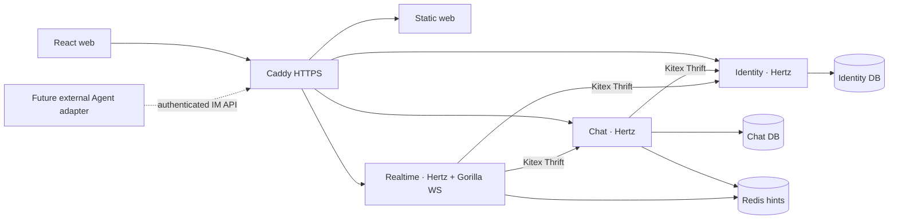

# Standalone IM architecture

Teamie's first release is an IM platform. Humans and future agents share the participant contract, membership rules and message protocol. Agent scheduling, model invocation, turns and sandbox execution are owned by a separate future system.

## Service ownership

| Service | Owns | Does not own |
| --- | --- | --- |
| Identity | User credentials, profiles, opaque sessions, CSRF tokens | Workspace admission and message authorization |
| Chat | Workspaces, memberships, conversations, message history, read cursor, durable sync and outbox | Login sessions and Agent execution |
| Realtime | Connections, heartbeats, disposable typing signals, sync hints | Message persistence and authorization policy |

All three binaries are independently built and deployed from the backend monorepo. Identity and Chat have separate PostgreSQL databases and application roles. They share an instance to fit the initial host; they do not query each other's tables. Membership and message writes are in Chat so authorization and persistence can share a transaction. Realtime checks authority through Kitex. It cannot bypass membership by querying storage directly.

The edge and web container are the only public application entry points. HTTP auth routes go to Identity; chat routes go to Chat; WebSocket upgrades go to Realtime. Internal HTTP/RPC, PostgreSQL and Redis ports stay on the container network. Browser APIs are same-origin.

## Message guarantees

1. The current server session determines the sender. A caller cannot impersonate another participant by supplying an ID.
2. A conversation serializes its message sequence. A client-generated message ID provides retry idempotence; changing content under the same ID is a conflict.
3. A transaction commits the message, authorized recipients' durable sync events and outbox together. API success means the data has committed.
4. Redis/WS provide at-least-once hints. Clients fetch durable events from HTTP sync and reconcile by message ID and event order.
5. Reconnect starts from the last applied per-account cursor. Pagination must drain all pages before assuming it is caught up. Invalid/future cursors fail explicitly.
6. Current membership is checked for history, sync, writes and typing delivery. Losing membership clears the client's cached view. Pending old protected events are filtered while the sync cursor continues advancing.
7. Retraction leaves a tombstone. Read cursors only advance. Disabling edit/retract does not make old content unreadable.

The outbox provides durable notification retry, while periodic sync covers lost hints. No exactly-once transport claim is made. A single host is not highly available; a failed host interrupts all services.

## Flags and permissions

Feature definitions and defaults are versioned in Git; protected production overrides carry a revision. Backend capability output is the intersection of implemented functionality, enabled flag and permission. The frontend consumes these capabilities and the backend independently enforces them. Attachments, reactions, threads, search and Agent execution are out of the first release.

## Initial infrastructure

One Debian x86_64 ECS host runs Docker Compose with Caddy, web, Identity, Chat, Realtime, PostgreSQL and Redis. Images are built on hosted GitHub runners and pulled by immutable GHCR digest. Infra images are mirrored to GHCR because direct Docker Hub access from the initial host is unreliable. Application data, PostgreSQL, certificate storage and backups have persistent storage; containers are replaceable.

A public IP uses an explicitly configured Let's Encrypt ACME `shortlived` issuer. The certificate must be publicly trusted and automatically renewed before release acceptance. Caddy's implicit internal CA for IPs is insufficient. See [Caddy TLS configuration](https://caddyserver.com/docs/caddyfile/directives/tls) and [Let's Encrypt IP certificate availability](https://letsencrypt.org/2026/01/15/6day-and-ip-general-availability).

Memory limits are initial budgets for a 2-vCPU/2-GB host, not measured capacity claims. Database connection pools, RPC concurrency and WS buffers must be bounded. Backups on the same disk provide recovery from mistakes but do not protect against losing the host; external backup storage remains a future operational addition.
